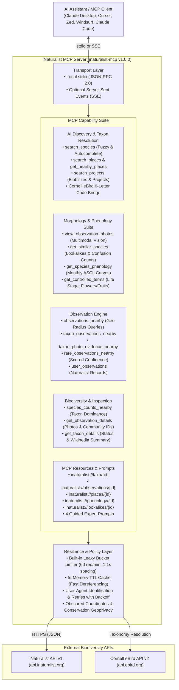

# iNaturalist MCP Server (`inaturalist-mcp`)

[](https://github.com/thesven/inaturalist-mcp/actions/workflows/ci.yml)
[](pyproject.toml)
[](LICENSE)
[]()
[]()
[](https://modelcontextprotocol.io)

A comprehensive, production-grade [Model Context Protocol (MCP)](https://modelcontextprotocol.io) server for the global [iNaturalist API v1](https://api.inaturalist.org/v1).

Equips LLMs and AI agent runtimes (Claude Desktop, Cursor, Zed, Windsurf, Claude Code, and autonomous multi-agent systems) to search over 200 million community-contributed wildlife observations, inspect high-resolution photographs with multimodal vision, compare confusing lookalikes and mimic species, verify 12-month phenology curves, resolve authoritative species taxonomy, bridge Cornell eBird sightings, discover protected reserves and parks, and monitor rare or threatened biodiversity.

---

## Architecture Overview



---

## Key Highlights

- **17 Native MCP Tools**: Complete coverage across species discovery, coordinate-based observations, verified photo evidence, lookalike confusion counts, seasonal phenology curves, biological controlled terms, and project tracking.
- **Multimodal Visual Inspection**: `view_observation_photos` streams base64 JPEG image blocks directly into vision-capable LLM context, enabling AI inspection of bill morphology, plumage patterns, wing venation, and leaf margins.
- **Lookalikes & Misidentification Analysis**: `get_similar_species` returns mutual community misidentification frequencies so models can distinguish tricky mimic pairs (e.g., Monarch vs. Viceroy).
- **Phenology & Seasonality Curves**: `get_species_phenology` retrieves 12-month observation histograms with rendered ASCII frequency bars, preventing seasonally impossible species recommendations.
- **Biological Controlled Terms**: `get_controlled_terms` queries official annotation terms (Life Stage, Flowers and Fruits, Evidence of Presence) to filter life-cycle observations.
- **Cross-MCP eBird Bridge**: Automatically resolves Cornell eBird 6-letter species codes (e.g., `ebird:rebwoo`, `mcp:ebird:baleag`) to official iNaturalist taxon IDs without manual lookup.
- **Leaky Bucket Limiter & In-Memory Caching**: Enforces a 1.1s spacing policy out-of-the-box to strictly adhere to iNaturalist's 60 req/min threshold, complemented by smart TTL caching for taxonomy and place lookups.
- **Conservation Geoprivacy Awareness**: Automatic detection of obscured coordinates for threatened or endangered species, ensuring AI models respect sensitive habitat protections.
- **MCP Resources**: Direct URI-based dereferencing for taxa (`inaturalist://taxa/{id}`), observations (`inaturalist://observations/{id}`), places (`inaturalist://places/{id}`), phenology curves (`inaturalist://phenology/{id}`), and lookalikes (`inaturalist://lookalikes/{id}`).
- **Guided Expert Prompts**: Pre-engineered naturalist workflows for specimen identification (`identify_specimen`), lookalike comparison (`lookalike_comparison`), biodiversity surveys (`biodiversity_survey`), and rare species expeditions (`find_rare_species`).
- **Strict Quality Gate**: 100% type-annotated, tested across Python 3.11–3.14 with $\ge$ 94% branch test coverage.

---

## Quick Start

You can run `inaturalist-mcp` directly without manual cloning:

### Using `uvx` (Recommended)

```bash
uvx inaturalist-mcp
```

### Using `pip`

```bash
pip install inaturalist-mcp
inaturalist-mcp
```

---

## Client Configuration

### Claude Desktop

Add this to your `claude_desktop_config.json`:
* **macOS:** `~/Library/Application Support/Claude/claude_desktop_config.json`
* **Windows:** `%APPDATA%\Claude\claude_desktop_config.json`
* **Linux:** `~/.config/Claude/claude_desktop_config.json`

```json
{
  "mcpServers": {
    "inaturalist": {
      "command": "uvx",
      "args": ["inaturalist-mcp"]
    }
  }
}
```

*Optional:* If you have an iNaturalist API token, provide it in `env`:
```json
{
  "mcpServers": {
    "inaturalist": {
      "command": "uvx",
      "args": ["inaturalist-mcp"],
      "env": {
        "INATURALIST_API_TOKEN": "your_token_here"
      }
    }
  }
}
```

### Cursor

Add to `.cursor/mcp.json` or your Global Cursor MCP settings:

```json
{
  "mcpServers": {
    "inaturalist": {
      "command": "uvx",
      "args": ["inaturalist-mcp"]
    }
  }
}
```

### Zed

Add to `~/.config/zed/settings.json`:

```json
{
  "context_servers": {
    "inaturalist": {
      "command": "uvx",
      "args": ["inaturalist-mcp"]
    }
  }
}
```

### Windsurf

Add to `~/.codeium/windsurf/mcp_config.json`:

```json
{
  "mcpServers": {
    "inaturalist": {
      "command": "uvx",
      "args": ["inaturalist-mcp"]
    }
  }
}
```

---

## Environment Variables & Configuration

| Variable | Required | Default | Description |
| :--- | :---: | :---: | :--- |
| `INATURALIST_API_TOKEN` | Optional | `None` | iNaturalist OAuth Bearer token for authenticated API queries and higher rate limits. |
| `INAT_API_TOKEN` | Optional | `None` | Alias for `INATURALIST_API_TOKEN`. |

---

## Deep-Dive Capabilities

### 1. Multimodal Visual Inspection (`view_observation_photos`)
Rather than forcing models to rely exclusively on observer text descriptions, `view_observation_photos` retrieves 500px medium-resolution observation images, encodes them as base64 JPEG byte streams, and embeds them directly into the conversation turn as native `ImageContent` blocks. Vision-capable models (Claude 3.5 Sonnet, Claude 3 Opus, GPT-4o) can immediately inspect:
- Diagnostic wing bars, eyering patterns, and bill culmen curves on birds.
- Ventral vs. dorsal wing patterns on Lepidoptera (e.g. postmedian line on viceroys).
- Leaf margins (entire, serrate, lobed) and leaf venation on botanic specimens.
- Hymenial surface structure (gills, pores, teeth) on fungal fruiting bodies.

### 2. Lookalike Confusion Matrix (`get_similar_species`)
iNaturalist's `/v1/identifications/similar_species` endpoint measures empirical observer confusion across hundreds of millions of identifications. By calling `get_similar_species(taxon_id)`, the model discovers:
- Top candidate species most frequently mistaken for the target organism.
- Mutual identification disagreement frequencies.
- Ranked risk of misidentification in a specific geographic place.

### 3. Seasonality Curves (`get_species_phenology`)
Prevents models from recommending phenologically impossible species (e.g., claiming a migratory warbler was seen in Michigan during January). The tool provides a structured 12-month table with an ASCII histogram:

```text
Month | Observations | Relative Seasonal Frequency
--- | ---: | ---
Jan | 42 | █
Feb | 89 | ██
Mar | 310 | ██████
Apr | 1,420 | ████████████████████████
May | 2,890 | ████████████████████████████████████████████████ (Peak)
Jun | 1,840 | ███████████████████████████████
Jul | 1,120 | ███████████████████
Aug | 940 | ████████████████
Sep | 1,650 | ████████████████████████████
Oct | 810 | ██████████████
Nov | 120 | ██
Dec | 30 | █
```

### 4. Cross-MCP Bridging with `thesven/ebird-mcp`
When used alongside [`thesven/ebird-mcp`](https://github.com/thesven/ebird-mcp), agents can freely exchange taxon queries between systems:
- Pass Cornell eBird 6-letter species codes (`ebird:baleag`, `mcp:ebird:rebwoo`) directly into `search_species` or taxon observation tools.
- Cross-verify eBird audio checklists with iNaturalist community photo evidence.
- Correlate seasonal abundance trends across both global citizen-science platforms.

### 5. Continuous Leaky Bucket Rate Limiting
To strictly honor iNaturalist's API acceptable use policy (sustained limit of 60 requests/minute, max burst 100 req/min), the server includes an in-memory thread-safe `LeakyBucketLimiter` enforcing a 1.1-second minimum request interval. Combined with an in-memory TTL cache (`SimpleCache`) storing taxonomy and place boundaries for 24 hours, the server guarantees zero HTTP 429 throttling errors.

---

## Example Natural Language Prompts

Try these prompts in Claude Desktop, Cursor, or your AI runtime:

- **Lookalike Comparison:**
  > *"Compare the diagnostic field marks between a Monarch Butterfly and a Viceroy Butterfly. Check their mutual confusion records and seasonality curves in Ohio."*

- **Visual Evidence Inspection:**
  > *"Find recent observation photos of Red-tailed Hawks in Golden Gate Park using `view_observation_photos` and inspect the patagial marks on their wings."*

- **Regional Biodiversity Audit:**
  > *"Run a biodiversity survey for Yellowstone National Park. What are the top 10 most observed plant and mammal species, and are any of them flagged with conservation notices?"*

- **eBird Cross-Lookup:**
  > *"Look up species code `baleag` from eBird, resolve its iNaturalist taxon details, and show me recent research-grade sightings near 43.65, -79.38."*

---

## Tool Reference

### AI Discovery & Species Resolution

| Tool | Parameters | Description |
| ---- | ---------- | ----------- |
| `search_species` | `query: str`, `rank?: str`, `iconic_taxa?: str`, `limit?: int` | Search and autocomplete species, genus, or family to find official taxon IDs. Supports eBird 6-letter codes (e.g. `baleag`). |
| `get_taxon_details` | `taxon_id: int` | Lookup complete taxonomic classification, conservation status, and Wikipedia summary. |
| `get_similar_species` | `taxon_id: int`, `place_id?: int` | Retrieve species most frequently confused or misidentified with a candidate taxon. |
| `search_places` | `query: str`, `limit?: int` | Search parks, cities, counties, and protected reserves for official place IDs. |
| `get_nearby_places` | `lat: float`, `lon: float`, `nelat?: float`, `nelng?: float`, `swlat?: float`, `swlng?: float` | Discover standard and community places intersecting coordinates or a bounding box. |
| `search_projects` | `query: str`, `limit?: int` | Search citizen science projects, bioblitz initiatives, and monitoring efforts. |

### Visual Inspection, Phenology & Traits

| Tool | Parameters | Description |
| ---- | ---------- | ----------- |
| `view_observation_photos` | `observation_id: int`, `max_photos?: int` | Fetch high-resolution observation images directly as base64 JPEG blocks for visual analysis. |
| `get_species_phenology` | `taxon_id: int`, `place_id?: int`, `lat?: float`, `lon?: float`, `radius_km?: int` | Retrieve 12-month seasonal occurrence curve with relative frequency ASCII bars. |
| `get_controlled_terms` | `taxon_id?: int` | Retrieve biological attribute terms (Life Stage, Flowers/Fruits, Evidence of Presence). |

### Observations & Evidence

| Tool | Parameters | Description |
| ---- | ---------- | ----------- |
| `observations_nearby` | `lat: float`, `lon: float`, `radius_km?: int`, `limit?: int`, `photos_only?: bool` | Fetch nearby biodiversity sightings within a radius (km). |
| `taxon_observations_nearby` | `taxon_query: str`, `lat: float`, `lon: float`, `radius_km?: int`, `limit?: int`, `photos_only?: bool` | Fetch nearby sightings for a specific taxon or organism name. |
| `rare_observations_nearby` | `lat: float`, `lon: float`, `radius_km?: int`, `limit?: int`, `taxon_query?: str` | Fetch lightly confirmed or sparsely identified research sightings. |
| `taxon_photo_evidence_nearby` | `taxon_query: str`, `lat: float`, `lon: float`, `radius_km?: int`, `limit?: int` | Fetch nearby sightings with verified photographic evidence. |
| `place_taxon_activity` | `lat: float`, `lon: float`, `radius_km?: int`, `limit?: int`, `taxon_query?: str` | Fetch recent taxon activity for a place or region. |
| `get_observation_details` | `observation_id: int` | Fetch full observation details, observer profile, obscured coordinates flags, and community IDs. |
| `user_observations` | `username: str`, `limit?: int`, `photos_only?: bool` | Fetch sightings recorded by a specific naturalist or researcher. |
| `species_counts_nearby` | `lat?: float`, `lon?: float`, `radius_km?: int`, `place_id?: int`, `taxon_id?: int`, `limit?: int` | Rank most frequently recorded species in an area for biodiversity profiling. |

---

## MCP Resources

Inspect raw records directly using MCP resource URIs:

- `inaturalist://taxa/{taxon_id}`: Taxon classification, conservation rank, and Wikipedia summary.
- `inaturalist://observations/{observation_id}`: Full observation metadata, photo URLs, and community identifications.
- `inaturalist://places/{place_id}`: Geographic boundary details and place hierarchy.
- `inaturalist://phenology/{taxon_id}`: Monthly phenological occurrence curve and histogram.
- `inaturalist://lookalikes/{taxon_id}`: Similar and frequently confused taxa with mutual misidentification counts.

---

## Guided Prompts

The server includes pre-configured prompts that guide models through systematic biodiversity workflows:

- **`identify_specimen`**: Guides step-by-step identification of an observed plant, animal, or fungus using morphological traits, location, phenology, and candidate lookalikes.
- **`lookalike_comparison`**: Performs a side-by-side diagnostic comparison between a candidate species and common mimics.
- **`biodiversity_survey`**: Generates a structured biodiversity report for a designated park, city, or coordinate radius.
- **`find_rare_species`**: Investigates rare, threatened, or sparsely confirmed wildlife sightings in an area.

---

## Development & Testing

### Installation

```bash
git clone https://github.com/thesven/inaturalist-mcp.git
cd inaturalist-mcp
uv sync --locked
```

### Running Tests & Coverage

```bash
uv run pytest --cov=inaturalist_mcp --cov-branch --cov-report=term-missing
```

### Running Linters & Formatters

```bash
uv run ruff check src tests scripts
uv run ruff format --check src tests scripts
```

### Packaging & Smoke Test

```bash
uv build
uv run python scripts/check_dist.py
uv run --no-project --with ./dist/inaturalist_mcp-*.whl python scripts/smoke.py
```

---

## Contributing

Contributions are welcome! Please review our [Contributing Guidelines](CONTRIBUTING.md) and [Security Policy](SECURITY.md) before submitting pull requests.

---

## License

MIT License. Copyright (c) 2026 Michael Svendsen. See [LICENSE](LICENSE) for details.
