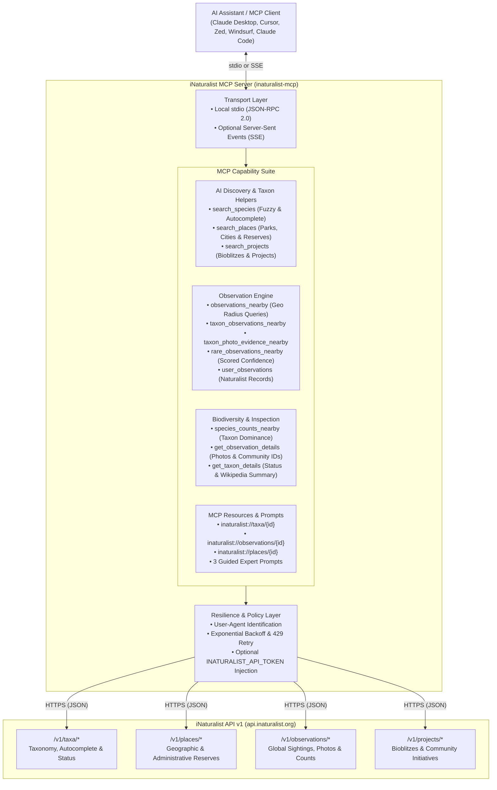

# iNaturalist MCP Server (`inaturalist-mcp`)

[](https://github.com/thesven/inaturalist-mcp/actions/workflows/ci.yml)
[](pyproject.toml)
[](LICENSE)
[]()
[]()
[](https://modelcontextprotocol.io)

A comprehensive, production-grade [Model Context Protocol (MCP)](https://modelcontextprotocol.io) server for the global [iNaturalist API v1](https://api.inaturalist.org/v1).

Equips LLMs and AI agent runtimes (Claude Desktop, Cursor, Zed, Windsurf, Claude Code, and custom autonomous agents) to search over 200 million community-contributed wildlife observations, inspect photographic evidence, resolve authoritative species taxonomy, survey regional biodiversity, look up protected areas and parks, discover citizen science projects, and identify rare or lightly confirmed species.

---

## Architecture Overview



---

## Key Highlights

- **12 Native MCP Tools**: Complete coverage across species discovery, coordinate-based observations, verified photo evidence, place exploration, species counts, and project tracking.
- **AI-First Discovery Helpers**: Built-in taxon autocomplete (`search_species`) and place resolution (`search_places`) so LLMs never have to guess taxon IDs or geographic bounding parameters.
- **Rare & Notable Sighting Analysis**: `rare_observations_nearby` scores research-grade observations by community confirmation levels to spotlight rare species, unusual range extensions, and lightly verified records.
- **MCP Resources**: Direct URI-based dereferencing for taxa (`inaturalist://taxa/{id}`), observations (`inaturalist://observations/{id}`), and places (`inaturalist://places/{id}`).
- **Guided Expert Prompts**: Pre-engineered naturalist workflows for specimen identification (`identify_specimen`), park biodiversity surveys (`biodiversity_survey`), and rare species expeditions (`find_rare_species`).
- **Resilient Network Client**: Automatic retries with exponential backoff for HTTP 429 rate limits, descriptive error hierarchies, and transparent connection pooling.
- **Strict Quality Gate**: 100% type-annotated, tested across Python 3.11–3.14 with branch test coverage exceeding 95%.

---

## Quick Start

You can run `inaturalist-mcp` directly without manual cloning:

### Using `uvx` (Recommended)

```bash
uvx inaturalist-mcp
```

### Using `pip`

```bash
pip install inaturalist-mcp
inaturalist-mcp
```

---

## Client Configuration

### Claude Desktop

Add this to your `claude_desktop_config.json`:
* **macOS:** `~/Library/Application Support/Claude/claude_desktop_config.json`
* **Windows:** `%APPDATA%\Claude\claude_desktop_config.json`
* **Linux:** `~/.config/Claude/claude_desktop_config.json`

```json
{
  "mcpServers": {
    "inaturalist": {
      "command": "uvx",
      "args": ["inaturalist-mcp"]
    }
  }
}
```

*Optional:* If you have an iNaturalist API token, provide it in `env`:
```json
{
  "mcpServers": {
    "inaturalist": {
      "command": "uvx",
      "args": ["inaturalist-mcp"],
      "env": {
        "INATURALIST_API_TOKEN": "your_token_here"
      }
    }
  }
}
```

### Cursor

Add to `.cursor/mcp.json` or your Global Cursor MCP settings:

```json
{
  "mcpServers": {
    "inaturalist": {
      "command": "uvx",
      "args": ["inaturalist-mcp"]
    }
  }
}
```

### Zed

Add to `~/.config/zed/settings.json`:

```json
{
  "context_servers": {
    "inaturalist": {
      "command": "uvx",
      "args": ["inaturalist-mcp"]
    }
  }
}
```

### Windsurf

Add to `~/.codeium/windsurf/mcp_config.json`:

```json
{
  "mcpServers": {
    "inaturalist": {
      "command": "uvx",
      "args": ["inaturalist-mcp"]
    }
  }
}
```

---

## Tool Reference

### AI Discovery & Species Resolution

| Tool | Parameters | Description |
| ---- | ---------- | ----------- |
| `search_species` | `query: str`, `rank?: str`, `iconic_taxa?: str`, `limit?: int` | Search and autocomplete species, genus, or family to find official taxon IDs and rank. |
| `get_taxon_details` | `taxon_id: int` | Lookup complete taxonomic classification, conservation status, and Wikipedia summary. |
| `search_places` | `query: str`, `limit?: int` | Search parks, cities, counties, and protected reserves for official place IDs. |
| `search_projects` | `query: str`, `limit?: int` | Search citizen science projects, bioblitz initiatives, and monitoring efforts. |

### Observations & Evidence

| Tool | Parameters | Description |
| ---- | ---------- | ----------- |
| `observations_nearby` | `lat: float`, `lon: float`, `radius_km?: int`, `limit?: int`, `photos_only?: bool` | Fetch nearby biodiversity sightings within a radius (km). |
| `taxon_observations_nearby` | `taxon_query: str`, `lat: float`, `lon: float`, `radius_km?: int`, `limit?: int`, `photos_only?: bool` | Fetch nearby sightings for a specific taxon or organism name. |
| `rare_observations_nearby` | `lat: float`, `lon: float`, `radius_km?: int`, `limit?: int`, `taxon_query?: str` | Fetch lightly confirmed or sparsely identified research sightings. |
| `taxon_photo_evidence_nearby` | `taxon_query: str`, `lat: float`, `lon: float`, `radius_km?: int`, `limit?: int` | Fetch nearby sightings with verified photographic evidence. |
| `place_taxon_activity` | `lat: float`, `lon: float`, `radius_km?: int`, `limit?: int`, `taxon_query?: str` | Fetch recent taxon activity for a place or region. |
| `get_observation_details` | `observation_id: int` | Fetch full observation details, photos, observer profile, coordinates, and community IDs. |
| `user_observations` | `username: str`, `limit?: int`, `photos_only?: bool` | Fetch sightings recorded by a specific naturalist or researcher. |
| `species_counts_nearby` | `lat?: float`, `lon?: float`, `radius_km?: int`, `place_id?: int`, `taxon_id?: int`, `limit?: int` | Rank most frequently recorded species in an area for biodiversity profiling. |

---

## MCP Resources

You can inspect raw JSON records directly using MCP resource URIs:

- `inaturalist://taxa/{taxon_id}`: Taxon classification, conservation rank, and Wikipedia summary.
- `inaturalist://observations/{observation_id}`: Full observation metadata, photo URLs, and community identifications.
- `inaturalist://places/{place_id}`: Geographic boundary details and place hierarchy.

---

## Guided Prompts

The server includes pre-configured prompts that guide models through systematic biodiversity inquiries:

- **`identify_specimen`**: Guides step-by-step identification of an observed plant, animal, or fungus using morphological traits, location, phenology, and candidate lookalikes.
- **`biodiversity_survey`**: Generates a structured biodiversity report for a designated park, city, or coordinate radius.
- **`find_rare_species`**: Investigates rare, threatened, or sparsely confirmed wildlife sightings in an area.

---

## Development & Testing

### Installation

```bash
git clone https://github.com/thesven/inaturalist-mcp.git
cd inaturalist-mcp
uv sync --locked
```

### Running Tests & Coverage

```bash
uv run pytest --cov=inaturalist_mcp --cov-branch --cov-report=term-missing
```

### Running Linters & Formatters

```bash
uv run ruff check src tests scripts
uv run ruff format --check src tests scripts
```

### Packaging & Smoke Test

```bash
uv build
uv run python scripts/check_dist.py
uv run --no-project --with ./dist/inaturalist_mcp-*.whl python scripts/smoke.py
```

---

## Contributing

Contributions are welcome! Please review our [Contributing Guidelines](CONTRIBUTING.md) and [Security Policy](SECURITY.md) before submitting pull requests.

---

## License

MIT License. Copyright (c) 2026 Michael Svendsen. See [LICENSE](LICENSE) for details.
